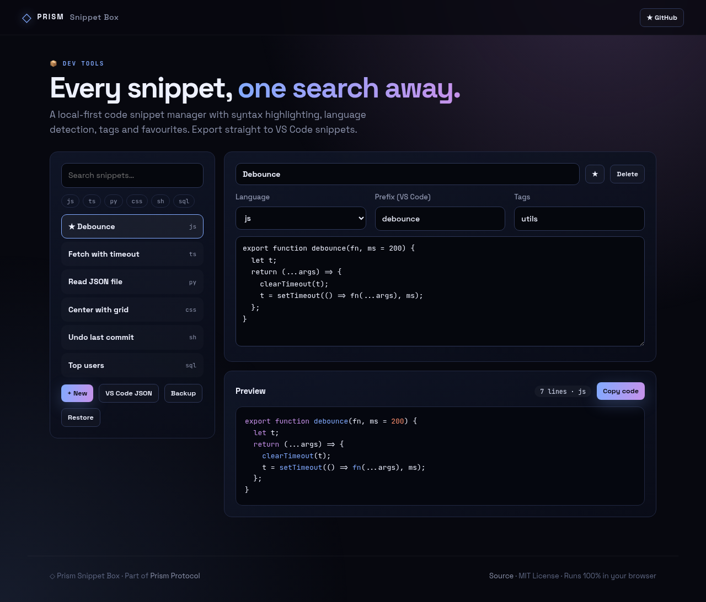
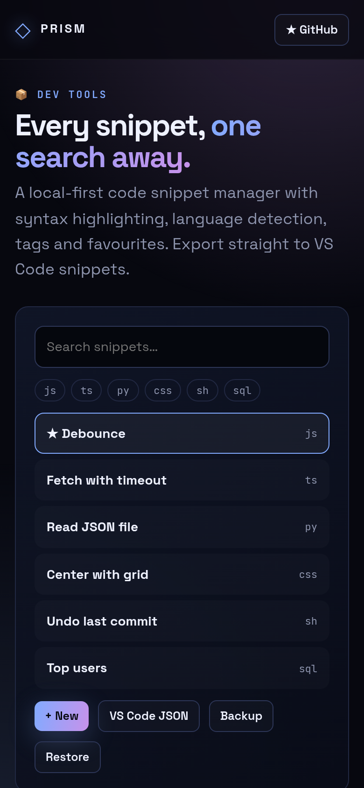

<!-- ═════════════ HEADER ═════════════ -->
<p align="center">
  
</p>

<p align="center">
  
</p>

<p align="center">
  <a href="https://github.com/krishyaa06/prism-snippet-box/actions/workflows/ci.yml"></a>
  <a href="https://krishyaa06.github.io/prism-snippet-box/"></a>
  
  
  <a href="LICENSE"></a>
</p>

<p align="center">
  
</p>


## ⚡ Overview

**Prism Snippet Box** is a home for the snippets you keep re-googling. Save code with a title, tags and a VS Code prefix; it auto-detects the language on first paste and highlights JavaScript, TypeScript, Python, Go, Rust, shell, CSS, HTML, JSON and SQL. Search across titles, tags and code, star favourites, then export your whole library as a VS Code `.code-snippets` file so the prefixes work in your editor.

## ✨ Features

- **Zero-dependency highlighter** for 10 languages
- **Language auto-detection** on first paste
- **Search** across title, code, tags and prefix; filter by language
- **Favourites** pinned to the top; Tab inserts spaces in the editor
- **Export** to VS Code `.code-snippets` (scope + prefix + body)
- **Backup / restore** as JSON; everything stays in your browser

## 📸 Screenshots

<table>
  <tr>
    <td width="68%"></td>
    <td width="32%"></td>
  </tr>
</table>

## 🚀 Quick Start

**Use it online:** [https://krishyaa06.github.io/prism-snippet-box/](https://krishyaa06.github.io/prism-snippet-box/)

**Run locally:**

```bash
git clone https://github.com/krishyaa06/prism-snippet-box.git
cd prism-snippet-box
# open index.html in your browser, or serve it:
npx serve .
```

## 🛠️ Usage

1. Click **+ New**, paste code and give it a title, prefix and tags.
2. Search or filter by language; ★ to favourite.
3. **VS Code JSON** downloads `prism.code-snippets` — put it in `.vscode/` (project) or your user snippets folder.

## 📁 Project Structure

```
prism-snippet-box/
├── assets/
│   ├── logo.png
│   └── logo.svg
├── css/
│   ├── app.css
│   └── prism.css
├── js/
│   ├── app.js   # library UI
│   ├── core.js   # highlighter, detector, search, exporters — tested in Node
│   └── prism.js
├── test/
│   └── core.test.js
├── .gitignore
├── LICENSE
├── index.html
└── package.json
```

## 🧪 Tests

```bash
npm test
```

Tests use the built-in `node:test` runner, so there is nothing to install. CI runs them on Node 20 and 22.

## 🤝 Contributing

1. Fork the repo and create a branch: `git checkout -b feature/my-idea`
2. Make your change and add a test in `test/`
3. Run `npm test` and open a Pull Request

## 🔷 Part of Prism Protocol

Prism Snippet Box is one of the open-source tools built by [Prism Protocol](https://dc.gg/prismprotocol), a tech community where young builders learn, ship and compete together.

## 👤 Author

<table>
  <tr>
    <td align="center">
      <a href="https://github.com/krishyaa06"><br><b>Soumya Bhandare</b></a><br>
      <sub>Founder @ Prism Protocol</sub>
    </td>
    <td>
      <a href="https://dc.gg/prismprotocol"></a><br>
      <a href="https://instagram.com/prism_protocol_"></a><br>
      <a href="https://x.com/krishyaa06"></a>
    </td>
  </tr>
</table>

## 📄 License

Released under the [MIT License](LICENSE).

<p align="center">
  <b>If you like this project, consider giving it a ⭐</b><br>
  <sub>"Build. Create. Compete." · Made with ⚡ by Prism Protocol</sub>
</p>


